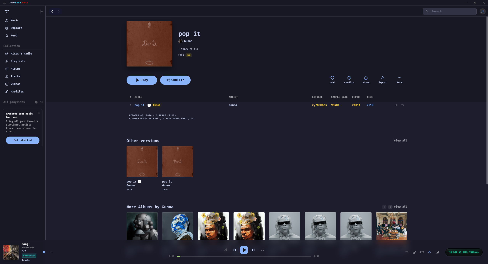

# MochaTidal

A Catppuccin Mocha theme for the TIDAL desktop app. It runs through TidaLuna's Themer plugin and restyles the app from a single CSS file.

## What it changes

- Solid Mocha surfaces for the sidebar, top bars, menus, and search.
- A frosted footer player.
- Blue for buttons, the active sidebar item, and the card play badge. The progress fill is Mauve.
- Artwork on cards is rounded to match, and the play badge is a clean blue circle.
- Tracklist headers line up with their columns.
- Footer order runs artwork, title, heart, then the three-dot button.
- FiraCode Nerd Font Mono SemiBold for all text.

The main column is translucent and blurs the soft blue and lavender glow behind it.

## Install

1. Install TidaLuna and enable the Themer plugin.
2. Open Themer's settings and choose Open editor, or press Ctrl+E.
3. Paste the whole of `MochaTidal.css` into the editor and apply it.

## Requirements

- TIDAL desktop 2.43.2 and TidaLuna 1.17.1-beta. These are the versions the theme was tested on, on Windows 11.
- FiraCode Nerd Font Mono installed locally for the font. Without it, text falls back to the system monospace font.

## Notes

- The selectors match TIDAL's class names. Most of them match a stable part of the name, such as `_card_` or `_tableHeader_`, but an app update can rename classes. If a part of the theme stops working after an update, start with the matching section of the file.
- The file is split into numbered sections, from tokens to fixes. Where two rules have equal weight, the later one wins, so keep the sections in order when you edit.

## Preview

## Contributing

Bug reports, feature ideas and pull requests are welcome. See [CONTRIBUTING.md](CONTRIBUTING.md) for setup, checks and what to include.

## Star history

⭐ Thanks for the stars, screenshots and theme fixes.

<a href="https://www.star-history.com/?repos=DavidHiFi%2FMochaTidal&amp;type=date">
  <picture>
    <source media="(prefers-color-scheme: dark)" srcset="https://api.star-history.com/chart?repos=DavidHiFi/MochaTidal&amp;type=date&amp;theme=dark&amp;legend=top-left" />
    <source media="(prefers-color-scheme: light)" srcset="https://api.star-history.com/chart?repos=DavidHiFi/MochaTidal&amp;type=date" />
    
  </picture>
</a>

## Credits

- The Catppuccin Mocha palette comes from [Catppuccin](https://github.com/catppuccin/catppuccin), MIT licensed.
- TidaLuna and its Themer plugin load and apply this file.

## License

MIT. See [LICENSE](LICENSE).
