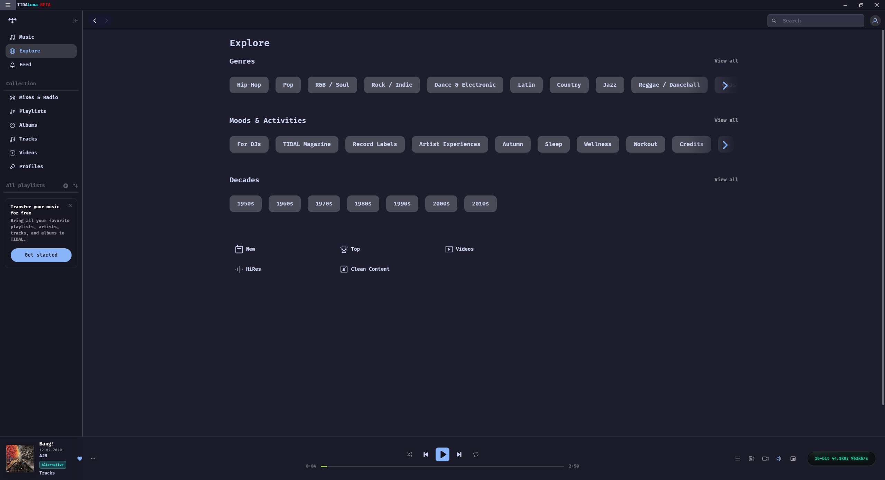

# MochaTidal

**A Catppuccin Mocha theme for the TIDAL desktop app, through TidaLuna's Themer plugin.**

Solid Mocha surfaces, frosted footer player, Blue buttons and progress fill, rounded artwork.

  

---

## Installation

Requires [TidaLuna](https://github.com/Inrixia/TidaLuna) and its Themer plugin.

1. Install TidaLuna and enable the Themer plugin.
2. Open Themer settings (Ctrl+E) and paste the contents of `MochaTidal.css` into the editor, then apply.

## Features

- **Mocha surfaces:** solid Catppuccin Mocha on the sidebar, top bars, menus and search.
- **Frosted player:** the footer player blurs what scrolls behind it.
- **Blue accents:** buttons, the active sidebar item and the play badge on cards.
- **Mauve progress bar:** the track progress fill.
- **Rounded artwork:** album and playlist covers get rounded corners.
- **Font:** FiraCode Nerd Font Mono SemiBold everywhere, falling back to your system monospace font if it is not installed.

## Notes

> [!NOTE]
> **Tested on TIDAL 2.43.2 with TidaLuna 1.17.1-beta.** TIDAL updates can rename the classes the theme targets. If part of the app looks wrong after an update, [open an issue](https://github.com/DavidHiFi/MochaTidal/issues/new) with a screenshot.

## Contributing

Bug reports with TIDAL version and theme file, feature ideas and pull requests welcome. See [CONTRIBUTING.md](CONTRIBUTING.md).

## Star history

Thanks for the stars and theme fixes.

<a href="https://www.star-history.com/?repos=DavidHiFi%2FMochaTidal&amp;type=date">
  <picture>
    <source media="(prefers-color-scheme: dark)" srcset="https://api.star-history.com/chart?repos=DavidHiFi/MochaTidal&amp;type=date&amp;theme=dark&amp;legend=top-left" />
    <source media="(prefers-color-scheme: light)" srcset="https://api.star-history.com/chart?repos=DavidHiFi/MochaTidal&amp;type=date" />
    
  </picture>
</a>

## Credits

- **Author:** Myself, [DavidHiFi](https://github.com/DavidHiFi)

| Who | What |
|---|---|
| **Catppuccin** ([catppuccin](https://github.com/catppuccin/catppuccin), MIT) | The Mocha colour palette. |
| **Inrixia** ([TidaLuna](https://github.com/Inrixia/TidaLuna)) | The TIDAL client mod and its Themer plugin, which load the CSS. |
| **Nerd Fonts** ([FiraCode Nerd Font](https://github.com/ryanoasis/nerd-fonts)) | The font the theme uses. |

Built with plain CSS for [TIDAL](https://tidal.com) through [TidaLuna](https://github.com/Inrixia/TidaLuna)'s Themer plugin.

> Missing or wrong credit? [Open an issue](https://github.com/DavidHiFi/MochaTidal/issues/new) and I'll fix it.

## Disclaimers

Most of this theme was developed with AI coding agents, including Claude Code, Codex and OpenCode. No single AI agent made the project.

Client mods like TidaLuna are not supported by TIDAL. Use them at your own risk.

 
Not affiliated with TIDAL, TidaLuna or Catppuccin. Requires the TIDAL desktop app and TidaLuna's Themer plugin.

